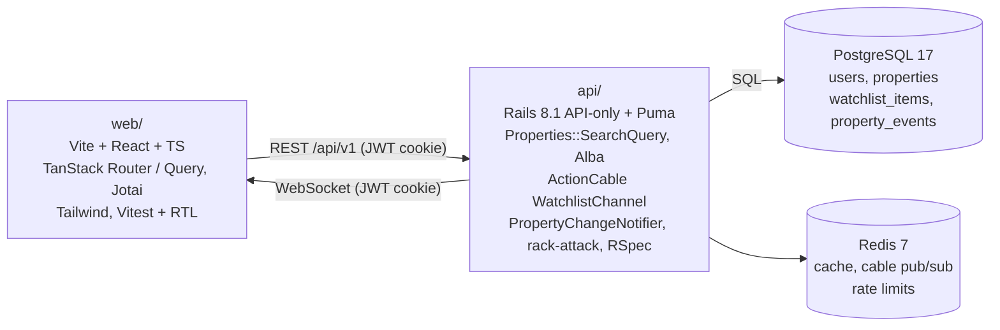

# PRD — Property Search & Watchlist

Last updated: Nov 22, 2026

## Overview & goals

We are building a small property search app. Users search Australian listings, filter by price, bedrooms and property type, scroll through results, and save properties to a personal watchlist that updates live when a watched property's price or status changes. It is built for a fullstack coding challenge with a timebox of **3–4 hours**.

**What success looks like:** a reviewer can clone the repo, run one command, and find each item on the challenge's evaluation criteria easy to locate in the code and the README.

| Rubric area | How this PRD answers it |
| --- | --- |
| API design & RESTful patterns | Versioned `/api/v1` resources, consistent envelope and error shape (API design) |
| Schema & relationships | `users`, `properties`, `watchlist_items`, `property_events` with FKs and unique constraints (Data model) |
| Component architecture | Feature-sliced React app; server state, URL state and client state kept apart (Frontend) |
| State management | TanStack Query for server state, TanStack Router for URL state, Jotai for client state |
| Query optimisation / N+1 | `watched` flag computed in one query; `bullet` raises on N+1 in the test suite |
| Indexing strategy | Composite and partial indexes matched to the filter shape, checked with `EXPLAIN ANALYZE` in the README |
| Frontend rendering | Memoised cards, stable callbacks, next batch requested before the user reaches the end; off-screen cards skip layout and paint with `content-visibility` (chosen over list virtualisation in Milestone 7) |
| Infinite scroll implementation | `useInfiniteQuery` + an IntersectionObserver sentinel and a “Load more” fallback over cursor (keyset) pagination (FR-3) |
| Error handling, auth, testing | Central `rescue_from`, JWT in an `HttpOnly` cookie with a fixed 24-hour expiry, RSpec + Vitest/RTL on critical paths |
| Bonus | Rate limiting, Redis caching, Docker Compose, real-time watchlist updates, saved searches if time allows |

## Stack decisions

The stack is a Rails 8.1 API with PostgreSQL 17 and ActionCable, plus a Vite React app using TanStack and Jotai, in one repo with two top-level folders (`api/`, `web/`) tied together by a Makefile and Docker Compose. Every technology the brief names is used as specified, with one deliberate swap: Vitest instead of Jest. Vitest is native to Vite and keeps Jest's API, so the tests are still written with React Testing Library. The other choices (TanStack, Jotai, Tailwind) only fill gaps the brief leaves open.

| Layer | Choice | Why |
| --- | --- | --- |
| Repo layout | `api/` + `web/` folders, root `Makefile` (`make setup`, `make dev`, `make test`) | Two apps don't need a monorepo tool; `make` gives one entry point with zero setup |
| Backend | Rails 8.1 `--api`, Puma | Required by the brief |
| Database | PostgreSQL 17, `pg_trgm` extension | Required; trigram indexes make free-text search fast |
| Pagination | Cursor (keyset) pagination, infinite scroll | Infinite scroll is on the rubric; keyset stays fast at any depth, and newly added listings never shift the rows already loaded. One honest limit: in a price sort, a listing whose price changes mid-scroll can show up twice or be missed (see Risks) |
| Serialisation | Alba, `lower_camel` keys | Light, plain Ruby, camelCase JSON for React |
| Auth | One JWT in an `HttpOnly; SameSite=Lax` cookie (`Secure` in production), fixed 24-hour `exp` (sliding renewal is Milestone 9) | The brief allows JWT or sessions. A JWT needs no server-side session store, and the `HttpOnly` cookie keeps it out of reach of JavaScript, so an XSS bug can't steal it. One token covers REST and the WebSocket. Assumes web and API on the same site (e.g. `app.` and `api.` subdomains). Milestone 1 is the minimum secure baseline; extra hardening is Milestone 9. Full design under Security hardening. |
| Real-time | ActionCable, Redis adapter | Required |
| Jobs | None for now: change broadcasts run inline after commit | Fan-out is small (a Redis publish per watcher, about 1 ms each), so a job adds moving parts without benefit, and inline sends also work from rake tasks and the console. At scale, move `PropertyChangeNotifier` into a Solid Queue job with retries; noted in the README |
| Rate limit / cache | rack-attack for every throttle: the scaffold's `auth/ip` and `api/ip` rules (Milestone 1 gives them their own store), per-route rules in Milestone 7; Redis cache store for app caching | rack-attack is already scaffolded and already returns the shared JSON error shape, so auth needs no second limiter; caching is bonus and needs a shared store |
| Frontend | Vite + React 19 + TypeScript, Tailwind | Requested; Tailwind for speed |
| Routing / URL state | TanStack Router, `validateSearch` with a zod schema | Type-safe filters in the URL. Zod 4 implements Standard Schema, so the schema plugs straight into `validateSearch`; `.catch()` turns bad values (e.g. `minBedrooms=banana`) into safe defaults, and the TS types come from the schema |
| Server state | TanStack Query | Caching, infinite queries, optimistic updates |
| Client state | Jotai | Small atomic UI state without Context re-render fan-out |
| N+1 detection | `bullet` (logs in development, raises in test; Milestone 3 moves it into the test group) | Catches N+1 queries automatically on every request spec instead of one hand-written spec per endpoint |
| Tests | RSpec (API); Vitest + React Testing Library + MSW (web) | Vitest replaces the brief's Jest: it reuses the Vite config (no separate Babel/SWC transform), keeps the Jest-style API (describe/it/expect) and runs in jsdom. Explained in the README |
| Infra | Docker Compose, GitHub Actions | Bonus: deployment considerations |

## Domain conventions we follow

The data model and filter names follow how Australian property portals already work, mainly [Domain's search API](https://developer.domain.com.au/static/latest/media/v1/openapi.json), so the app feels familiar to anyone in the industry.

- **Filter names:** `minPrice`, `maxPrice`, `minBedrooms`, `propertyTypes[]`, plus `q`, `excludeUnderOffer`, `excludePriceWithheld`, `sort`, `cursor`, `limit`. Rails stays snake\_case internally; Alba's `transform_keys :lower_camel` makes the JSON camelCase for React.
- **Property types:** `house`, `apartment_unit`, `townhouse`, `villa`, `land`, `acreage`, `rural`, `block_of_units`, `retirement_living`. A short, realestate.com.au-style list rather than Domain's 20+ values.
- **Statuses:** `for_sale`, `under_offer`, `sold`, `withdrawn`, with an “Exclude under offer” toggle as Domain has.
- **Prices:** a number and a display string stored separately (Domain's `price` / `displayPrice`), because many listings show “Contact agent”.
- **Addresses:** `SUBURB STATE POSTCODE`, 8 state codes, 4-digit postcodes, land size in m².
- **Alerts:** Domain's Shortlist alerts on price change, under offer and sold, which is why `property_events` has exactly two kinds: `price_changed` and `status_changed`.

## Scope

The must-haves are the challenge's functional list plus auth and live watchlist updates. Everything else is ranked by how well it scores per hour spent.

**User stories**

1. As a visitor, I can sign up and log in so my watchlist is mine.
2. As a user, I can search by suburb, postcode or address and see results as cards that keep loading as I scroll.
3. As a user, I can narrow results by price range, minimum bedrooms and one or more property types. My filters live in the URL, so I can share or refresh the page without losing them.
4. As a user, I can add a property to my watchlist or remove it from any card, and the change shows straight away.
5. As a user, I see my watchlist on its own page.
6. As a user, when a watched property changes price or status (for example, sold), my screen updates and a toast tells me, with no refresh.
7. *(Nice to have, Milestone 8)* As an admin, I can list, create, edit and delete properties in a simple admin screen, so I can add data and change prices or statuses visually. When I change a watched property, its watchers see the live update.

**In scope (must):** stories 1–6, loading, empty and error states, seed data, Docker Compose, README.

**Bonus, in order:** rate limiting (rack-attack) → admin UI for properties (story 7) → HTTP caching with ETag and a Redis cache for counts → saved searches → location search by radius.

**Out of scope:** maps, images beyond a placeholder URL, image uploads, bulk import, user management in the admin, email alerts, password reset, mobile app.

## Functional requirements

Each requirement below has acceptance criteria a test can check.

**FR-1 Search & results**

- Free-text `q` matches suburb or street (case-insensitive, partial match) or the start of a postcode (`30` finds `3065`). `q` shorter than 2 characters (after trimming) is ignored, so typing one letter doesn't error or fire a full-table match.
- Results show as cards: price display, address, suburb/state/postcode, beds/baths/cars, land size (m²), property type, status badge, and a watch toggle.
- Default sort is newest listed. Other sorts: price low→high and high→low. Price sorts leave out listings with no numeric price (“Contact agent”), and the UI notes that price sorts hide withheld prices.
- Loading shows skeleton cards. An empty result explains which filters to loosen. An error shows a retry button.

**FR-2 Filters**

- Price: min and max set from fixed steps. Min greater than max is blocked in the UI and returns 422 from the API.
- Bedrooms: Any, 1+, 2+, 3+, 4+, 5+ (a minimum, not an exact count).
- Property type: multi-select over House, Apartment & Unit, Townhouse, Villa, Land, Acreage, Rural, Block of Units, Retirement Living.
- Status: search always returns active listings, meaning **for sale and under offer**; there is no `status` param. An “Exclude under offer” toggle narrows that to for sale only. Sold and withdrawn listings never appear in search.
- An “Exclude price withheld” toggle hides listings with no numeric price.
- Changing a filter starts a fresh result set from the top (new query key, no cursor). Free-text input is debounced by 300 ms.

**FR-3 Infinite scroll**

- Results load in batches of 20 (`limit` capped at 50). The next batch is requested when a sentinel row comes within about 600 px of the viewport.
- The API uses keyset pagination with an opaque `nextCursor`. The end of the list is signalled by `hasMore: false`, which shows an “End of results” marker.
- The header shows the total once (“1,284 properties”), taken from the first response.
- While a batch loads, a row of skeleton cards appears at the bottom. If it fails, an inline “Retry” appears there without losing the results already loaded.
- *(Milestone 7)* Long lists stay cheap to render without virtualisation: each card has `content-visibility: auto` with a placeholder height matched to the real card, so off-screen cards skip layout and paint but stay in the DOM, in find-in-page and in the accessibility tree, and Back still lands on the same card. TanStack Virtual was considered and dropped (see `docs/features/performance.md` for why).
- Going back from a property keeps the loaded batches and scroll position (Query cache + router scroll restoration). A “Back to top” button appears once more than one batch is loaded and the page is scrolled past the first screen; it moves focus to the page heading.
- Keyboard and screen-reader users get a visible “Load more” button as a fallback to the sentinel.

**FR-4 Watchlist**

- Add and remove are idempotent. Adding twice returns 200 with the existing item. Removing an item that isn't there returns 204.
- The toggle updates optimistically and rolls back with a toast if the request fails.
- Fast repeated clicks end in the state of the last click. Toggles for the same property are queued (a TanStack Query mutation `scope` per property), so a `PUT` and a `DELETE` can never finish out of order and leave the button and the server disagreeing.
- The watchlist page uses the same infinite list component, sorted by date added. Unwatching there keeps the card in place (showing “Watch”, so one click undoes it) and marks the list stale, so it refreshes on the next visit instead of the card vanishing under the cursor. Its query is not scoped to `Property.active`, so a watched property that sells or is withdrawn stays on the watchlist with its new badge.
- Signed-out users who click watch are sent to log in, then returned to the same page.

**FR-5 Auth**

- Sign up, log in, log out, and `GET /me`. Email is unique and case-insensitive (stored trimmed and lowercased). Password is 12–72 characters (72 is bcrypt's byte limit). Rejecting breached passwords is a Milestone 9 item.
- Search is public. Watchlist endpoints and the cable connection require auth.
- Errors about the whole form (wrong email or password, too many attempts, anything unexpected) show as toasts. Errors about one field (for example, a password that's too short) stay next to that input. Signing in, creating an account and signing out each confirm with a toast (“Signed in”, “Account created”, “Signed out”).
- Logging out in one tab signs out every other open tab of the app in that browser straight away. Those tabs switch to the signed-out view (the header shows “Sign in”, Watch asks you to sign in) and show the toast “You were signed out in another tab”. A tab on a protected page (`/watchlist`) goes to `/login?next=…`; a tab on a public page stays where it is, because search doesn't need an account.
- If a request gets a 401 anyway (logout on another device, or the 24-hour token expired), the app does the same with the toast “You've been signed out”. An action that needs sign-in, like Watch, also goes to `/login?next=…`. The login form's own 401 is a wrong password, not a sign-out: it shows the “Invalid email or password” toast, not the signed-out one.

**FR-6 Real-time updates**

- When a watched property's price or status changes, every open tab of each watcher gets the update within about 1 s.
- The card and any cached result batch update in place. A toast reads, for example, “12 Smith St: $850k → $820k”.
- Updates apply in order. Each property carries a `version` (its `lock_version`, which Rails bumps on every save) in the REST shape and in the cable payload, and the client applies an update only if its `version` is newer than the cached card's. A late or repeated message can't put an older price back. (Writes that skip callbacks, like `update_columns`, don't bump it; nothing in the app uses them on properties.)
- A card whose new status no longer matches the current filters (for example, it just sold) stays in the list with its new badge until the next refetch, instead of vanishing under the user's cursor. Noted in the README.
- A rake task `demo:simulate_changes` changes random watched properties so reviewers can see it work. `demo:change_property[id,price=…|status=…]` changes one property on demand, and `demo:watched[email]` lists the ids a user watches so the README can point at a real one. Edits made in the admin screen trigger the same update.

**FR-7 Admin property management (nice to have, Milestone 8)**

Until this is built, data comes from the seed script and the `demo:*` rake tasks.

- Only users with the `admin` role can open `/admin` or call `/api/v1/admin/*`. Everyone else gets 403 from the API, and the UI hides the admin link and redirects away from admin routes. The server check is the real one; the UI check is only for convenience.
- The admin list is a table of properties (address, suburb, price, type, status, updated at), newest updated first, 50 per page with numbered pages, and a text filter on address/suburb/postcode.
- One form serves create and edit, with every property field. Property type and status are dropdowns filled from the API. Field errors from a 422 show next to the field.
- Edits use optimistic locking (`lock_version`). If two admins edit the same property, the second save returns 409 and the form asks them to reload.
- Delete asks for confirmation and explains that the property also leaves every watchlist. Changing status to `withdrawn` is offered as the softer option.
- Every admin change goes through the `Property` model, so price and status changes write a `property_events` row and reach watchers live, exactly like the rake tasks.
- The seed (Milestone 2) already creates one admin (`admin@example.com`) and one normal demo user (`demo@example.com`), so this milestone only adds screens and endpoints. Sign-up always creates a normal user; the role can't be set through the API.

## Repo structure

The repo has two apps side by side, a Rails API in `api/` and a Vite React web app in `web/`. A root `Makefile` is the single entry point: `make setup` once, then `make dev` (Postgres and Redis in Docker, Rails and Vite running natively for fast reloads) or `make up` (everything in Docker). CI runs one job per app.



The browser calls Rails over REST and gets watchlist updates back over one WebSocket. Postgres is the source of truth. Redis backs the cache, cable pub/sub and rate limits.

In development, Vite proxies `/api` and `/cable` to Rails, so the browser sees one origin. Production assumes the web app and API sit on **same-site subdomains** (see Security hardening). CORS and cable origins still come from `FRONTEND_ORIGIN`. The web app calls same-origin `/api/v1` and `/cable` paths, so moving to subdomains needs a reverse proxy in front of `app.` or a configurable API base URL. Fully separate domains are a Milestone 9 fallback.

```
property-search/
  api/            Rails 8.1 --api (Dockerfile for production, Dockerfile.dev for Compose)
  web/            Vite React TS (Dockerfile.dev, Vitest + RTL, Tailwind)
  docker-compose.yml   db, redis, api, web
  Makefile        setup, dev, test, seed, up, down
  .github/workflows/ci.yml   api: rspec + rubocop; web: lint + typecheck + test
  README.md       setup, decisions, trade-offs, EXPLAIN output, what I'd do next
```

**Environment variables:** `DB_HOST`, `REDIS_URL`, and `FRONTEND_ORIGIN` (comma-separated list of web origins allowed by CORS and ActionCable) on the API; `API_PROXY_TARGET` for the Vite dev proxy on the web app.

## Data model & indexing

The schema has four tables. Every index maps to a real query, and each one is shown with `EXPLAIN ANALYZE` in the README. Those plans are captured from the real ActiveRecord query (`Properties::SearchQuery.new(params).relation.explain(:analyze)`), not hand-written SQL, so they prove the index matches what Rails actually sends. They are captured with `SEED_COUNT=100000`, because at 10k rows Postgres often prefers a plain table scan and the indexes wouldn't show. Indexes are partial where every query shares the same condition (active listings), which keeps them smaller. Any index that `EXPLAIN` shows is never used gets dropped.

| Table | Key columns | Constraints |
| --- | --- | --- |
| `users` | `email` (string, stored lowercased via `normalizes`), `password_digest`, `name`, `role` (enum: user, admin; default user; added in Milestone 2 so the seed can create the admin) | unique `email`; CHECK on `role` |
| `properties` | `street_address`, `suburb`, `state` (NSW…ACT), `postcode` (string, CHECK `^[0-9]{4}$`), `latitude`, `longitude`, `price_cents` (bigint, nullable), `price_display` (e.g. “Contact agent”), `bedrooms`, `bathrooms`, `car_spaces` (smallint), `land_size_sqm`, `property_type` (string), `status` (string: for\_sale, under\_offer, sold, withdrawn), `listed_at`, `image_url`, `lock_version` | NOT NULL + CHECK on the allowed string values and non-negative numbers |
| `watchlist_items` | `user_id`, `property_id`, `created_at` | FKs `on_delete: cascade`, unique (`user_id`, `property_id`) |
| `property_events` | `property_id`, `kind` (price\_changed, status\_changed), `from_value`, `to_value`, `created_at` | FK; written in the same transaction as the change (`after_update`, not `after_commit`) |
| `saved_searches` (bonus) | `user_id`, `name`, `params` (jsonb) | FK |

Auth needs no extra table in Milestone 1: the JWT cookie is self-contained. A `sessions` table for revocation and device lists is a Milestone 9 item.

We store `price_cents` and `price_display` separately because Australian listings often hide the price. Filters use the number, and the card shows the text. Listings with no price are left out when a price filter is set.

`status` and `property_type` are **string-backed** columns: Rails `enum` with string values (`enum :status, { for_sale: "for_sale", … }`) plus a CHECK constraint on each. Integer-backed enums would turn the index predicates below into `status IN (0, 1)`, which is unreadable and easy to get out of step. "Active" is one scope, `Property.active` → `where(status: %w[for_sale under_offer])`, and its SQL (`status IN ('for_sale', 'under_offer')`) matches the partial-index predicate exactly, so Postgres can use the partial indexes. Every search goes through that scope.

**Indexes**

| Index | Serves |
| --- | --- |
| btree (`listed_at DESC`, `id DESC`) **WHERE status IN ('for_sale', 'under_offer')** | Default “newest” feed. Postgres walks the index in order and stops after `limit + 1` matches, so broad searches never sort the whole table |
| btree (`price_cents`, `id`) **WHERE status IN ('for_sale', 'under_offer') AND price_cents IS NOT NULL** | Price low→high, and high→low by scanning the same index backwards. The `IS NOT NULL` condition matches the rule that price sorts leave out withheld prices |
| btree (`property_type`, `bedrooms`) **WHERE status IN ('for_sale', 'under_offer')** | Narrow searches (e.g. “villas, 4+ beds”), where it's cheaper to find the few matches first and sort them than to walk the feed index |
| GIN `gin_trgm_ops` on `suburb` and on `street_address`; btree `text_pattern_ops` on `postcode` | Free-text `q`: `suburb ILIKE '%q%' OR street_address ILIKE '%q%' OR postcode LIKE 'q%'` (a BitmapOr of the three). A plain btree can't serve `'%30%'`, so postcodes are prefix-matched. Trigrams only narrow from 3 characters, so a 2-character `q` mostly leans on the postcode prefix |
| unique (`user_id`, `property_id`) on `watchlist_items` + btree (`property_id`) | Watch lookups, and finding watchers when a property changes |
| btree (`property_id`, `created_at DESC`) on `property_events` | Change history for a property |
| btree (`updated_at DESC`, `id DESC`) (Milestone 8) | Admin list, newest edits first |

Seed data uses about 10k properties by default (`SEED_COUNT` overrides it) across real suburb/postcode pairs from all 8 states and territories, built with Faker plus a small CSV of suburbs. It is generated with `insert_all` so seeding takes a few seconds. About 10% have a withheld price and about 15% are under offer, so every filter and toggle has something to show.

## API design

The API is versioned under `/api/v1`. It returns JSON and uses one success envelope and one error shape on every endpoint.

| Method & path | Auth | Purpose |
| --- | --- | --- |
| `POST /auth/signup` | – | Create user → 201 with the user; sets the `HttpOnly` auth cookie |
| `POST /auth/login` | – | Same response and cookie → 200 (401 on bad credentials, 429 when throttled) |
| `DELETE /auth/logout` | yes | Clear the cookie, disconnect live sockets → 204 |
| `GET /auth/sessions`, `DELETE /auth/sessions` | yes | List devices / log out everywhere (Milestone 9) |
| `GET /me` | yes | Current user, including `role` so the UI knows whether to show the admin link |
| `GET /properties` | optional | Search, filter, sort, paginate |
| `GET /properties/:id` | optional | Property detail + recent `property_events` |
| `GET /property_types` | – | Enum list so the UI never hard-codes it |
| `GET /watchlist` | yes | Paginated watched properties |
| `PUT /watchlist/:property_id` | yes | Watch, idempotent → 200/201 (`create_or_find_by!`, so two concurrent PUTs both succeed against the unique index) |
| `DELETE /watchlist/:property_id` | yes | Unwatch, idempotent → 204 |
| `GET /admin/properties` | admin (Milestone 8) | Paged list (`page`, `perPage` ≤ 100, `q`) with `meta.totalCount` and `meta.totalPages` |
| `GET /admin/properties/:id` | admin (Milestone 8) | One property, including `lockVersion` |
| `POST /admin/properties` | admin (Milestone 8) | Create → 201; invalid → 422 with field errors |
| `PATCH /admin/properties/:id` | admin (Milestone 8) | Update; needs `lockVersion`; stale → 409 `stale_record` |
| `DELETE /admin/properties/:id` | admin (Milestone 8) | Delete → 204; watchlist items cascade |
| `GET/POST/DELETE /saved_searches` | yes | Bonus |

Using `PUT`/`DELETE` keyed on `property_id` makes the toggle idempotent. The client never needs a watchlist-item id.

Admin endpoints (Milestone 8) live in their own `Api::V1::Admin` namespace, behind a base controller that runs `authenticate!` and then `require_admin!` (403). The admin list uses simple numbered pages rather than the cursor, because admins jump between pages and the table is small enough (10k rows) for `OFFSET` to stay fast. Admin params are allow-listed with strong params, so `id`, timestamps and `role`-like fields can never be mass-assigned.

**Search parameters:** `q`, `minPrice`, `maxPrice` (whole AUD), `minBedrooms`, `propertyTypes[]`, `excludeUnderOffer`, `excludePriceWithheld`, `sort` (`newest` | `price_asc` | `price_desc`), plus the paging params below. There is no status param: search always runs on `Property.active` (for sale + under offer), and `excludeUnderOffer` narrows it to for sale. `q` is trimmed and ignored when shorter than 2 characters. Names follow Domain's API, and JSON keys are camelCase. Params are validated by a small query object, `Properties::SearchQuery` (`app/queries/properties/search_query.rb`; not `PropertySearch`, which is the Rails app's module name), and invalid values return 422.

**Paging parameters (all optional)**

| Param | Default | Rules |
| --- | --- | --- |
| `limit` | 20 | 1–50; out of range → 422 |
| `cursor` | none (first batch) | Opaque value from `meta.nextCursor`; tampered → 422 |
| `offset` (Milestone 9) | 0 | ≥ 0, at most 10,000; only used when no `cursor` is sent |

The defaults and caps live in one config (`config/pagination.yml`, overridable by `PAGINATION_DEFAULT_LIMIT` / `PAGINATION_MAX_LIMIT` env vars), so they can change without touching code. Sending both `cursor` and `offset` returns 422, because the two modes can't be combined.

**Two paging modes, one endpoint:** `Properties::SearchQuery` picks the mode from the params. Milestone 3 builds cursor mode only, which is all the web app needs. Offset mode is a Milestone 9 item for API clients that want to jump to a position.

- **Cursor (default, used by the web app):** the cursor holds the last row's sort value and `id`, e.g. `[listed_at, id]`, and is **signed** so it can't be edited (encryption is Milestone 9; see Security). Postgres stores `listed_at` in microseconds but JSON times carry milliseconds, so the cursor stores `listed_at` as **integer microseconds** (not the serialised string); otherwise rows sharing a millisecond would be skipped or repeated. The next query is `WHERE (listed_at, id) < (?, ?) ORDER BY listed_at DESC, id DESC LIMIT limit + 1`, and the extra row decides `hasMore`. Price sorts use `(price_cents, id)` and leave out price-withheld listings, and the UI says so. Price low→high uses `(price_cents, id) > (?, ?)`; high→low scans the same index backwards with `(price_cents, id) < (?, ?)`.
- **Offset (when `offset` is sent):** `ORDER BY …, id LIMIT limit + 1 OFFSET offset`. This is for clients that want to jump to a position. The 10,000 cap keeps deep offsets from getting slow.

Both modes return the same `meta`: `limit`, `hasMore`, `nextCursor` (cursor mode) or `nextOffset` (offset mode), and `totalCount`, computed only for the first request and cached.

**Success envelope**

```json
{
  "data": [{ "id": 42, "streetAddress": "12 Smith St", "suburb": "Fitzroy", "state": "VIC", "postcode": "3065",
             "priceCents": 85000000, "priceDisplay": "$850,000", "bedrooms": 3, "bathrooms": 2, "carSpaces": 1,
             "landSizeSqm": 320, "propertyType": "house", "status": "for_sale", "watched": true, "listedAt": "2026-11-01T00:00:00Z" }],
  "meta": { "limit": 20, "nextCursor": "eyJ2IjpbMTc5MzQ5MTIwMDAwMDAwMCw0Ml19--8f3c1a…", "hasMore": true, "totalCount": 1284 }
}
```

**Error shape:** `{ "error": { "code": "validation_failed", "message": "…", "details": { "maxPrice": ["must be greater than or equal to minPrice"] } } }` (detail keys are camelCase like every other JSON key). One `rescue_from` layer in `Api::V1::BaseController` maps errors: `RecordNotFound` → 404, `ParameterMissing` → 400 `parameter_missing` (as the scaffold's `ApplicationController` already does), invalid values and `RecordInvalid` → 422 `validation_failed`, unauthenticated → 401, not an admin → 403, `StaleObjectError` → 409, throttled → 429 with `Retry-After`.

**Avoiding N+1:** the property list is one query. `watched` comes from a single `LEFT JOIN watchlist_items … AND user_id = ?` selected as a boolean, not a lookup per row. The total count is a separate `COUNT` on the filtered base scope, before the `LEFT JOIN` and the custom `select(… AS watched)` are added (calling `.count` on the relation with that select breaks the SQL), cached for 60 s keyed by the normalised params. Serialisation uses Alba, a fast, plain-Ruby serializer.

## Real-time design (ActionCable)

Each signed-in user subscribes to one stream, `WatchlistChannel`, scoped to that user. When a property changes, the server fans the event out only to the users who watch it.

1. **Inside the transaction:** `Property` has an `after_update` callback. If `price_cents` or `status` changed, it writes a `property_events` row. The new price and its log entry are saved together or not at all, so the history can never miss a change.
2. **After commit:** an `after_update_commit` callback calls `PropertyChangeNotifier.call(property)`. Watchers are only told about changes that are really saved, never about one that gets rolled back.
3. `PropertyChangeNotifier` walks the watcher `user_id`s with the `property_id` index and calls `WatchlistChannel.broadcast_to(user, payload)` inline. There's no background job: each broadcast is a Redis publish of about 1 ms, and running inline means changes made from a rake task or `rails console` are delivered before the process exits.
4. The payload is `{ type: "property.updated", property: <same serializer as REST>, changes: { priceCents: [old, new], status: [old, new] } }` (only the keys that changed, camelCase like every JSON key). Reusing the REST shape means the client can drop it straight into its cache. The REST serializer reads `watched` from the search query's `LEFT JOIN`, which a plain `Property` loaded by the notifier doesn't have, so `PropertyChangeNotifier` passes `watched: true` as serializer params. That is always correct, because only watchers receive the broadcast.
5. `ApplicationCable::Connection` identifies `current_user` from the same auth used by REST and rejects anonymous connections.
6. On the client, one `useWatchlistChannel` hook (mounted once in the root layout) cancels in-flight fetches of the lists that show the card (not lists still on their first load), then calls `queryClient.setQueriesData` on every `['properties', …]` and `['watchlist', …]` cache holding that id, skipping any card whose `version` is already the same or newer and keeping the card's own `watched` flag. It pushes a toast into a Jotai atom once per new version, also when no list on that tab holds the card, and never for a message older than the cached card.
7. When the socket reconnects (`connected({ reconnected: true })`), the client refetches the watchlist and marks search batches stale, so changes missed while offline are picked up.

```ruby
class Property < ApplicationRecord
  after_update        :record_change_events, if: :price_or_status_changed? # same transaction; one row per changed attribute
  after_update_commit :notify_watchers,     if: :price_or_status_changed?  # after commit

  private

  # In after-callbacks `price_cents_changed?` is already false; use saved_change_to_*.
  def price_or_status_changed? = saved_change_to_price_cents? || saved_change_to_status?
end
```

The event row's `from_value`/`to_value` come from `saved_change_to_price_cents` / `saved_change_to_status` (the `[old, new]` pair) for the same reason.

Note: `update_all` and `insert_all` skip callbacks, so the demo tasks and admin edits use `update!`. The seed uses `insert_all` on purpose: seeding shouldn't broadcast anything.

**Adapters:** Redis in Docker and dev, `test` adapter in specs. No background-job backend is needed yet; see Stack decisions.

**Why one per-user stream instead of a stream per property:** a user with 50 watched properties holds 1 subscription instead of 50. Authorisation is also built in, because a user can only ever receive their own stream.

## Frontend architecture

State is split three ways, and no piece of state lives in two places. This split is the main thing to explain in the README, because “state management approach” is on the rubric.

| Kind of state | Owner | Examples |
| --- | --- | --- |
| Server state | TanStack Query | search pages, watchlist, `/me` |
| URL state | TanStack Router search params, validated by a zod schema in `validateSearch` | `q`, price, beds, types, sort (cursors stay in the Query cache, not the URL) |
| Client/UI state | Jotai | toasts, cable connection status (the sign-in return target lives in the URL as `?next=`) |

Filters are **not** copied into Jotai. The URL is their single source of truth, so back/forward, refresh and shared links all work without sync code.

**Routes:** `/` → `/search`, `/search`, `/watchlist` (protected via the route's `beforeLoad`), `/login`, `/signup`, and, in Milestone 8, `/admin/properties`, `/admin/properties/new`, `/admin/properties/$id/edit` (admin only, checked in `beforeLoad` against `/me`). Property detail is optional.

**Folder layout (feature-sliced)**

```
web/src/
  main.tsx, router.tsx   entry point, route tree, providers
  routes/         root layout, login and signup pages (search and watchlist pages live in their features)
  features/
    properties/   SearchPage, FilterBar (text, price, beds, types, toggles, sort), PropertyResultCard, hooks (useSearchProperties, usePropertyTypes), cache (patchCachedProperty), searchSchema (zod, used by validateSearch)
    watchlist/    WatchlistPage, WatchButton, useToggleWatch, useWatchlistChannel
    auth/         LoginForm, SignupForm, useMe, requireAuth, session (clearUserData, BroadcastChannel), useSessionEvents, requireAdmin (Milestone 8)
    admin/        (Milestone 8) AdminPropertiesPage (table + pager + filter), PropertyForm (create/edit), useAdminProperties, useSaveProperty, useDeleteProperty
  components/
    ui/           PropertyCard, InfiniteResults (list + sentinel + Load more; `content-visibility` on cards), Skeleton, states (EmptyState, ErrorState), Toaster + toast atoms
  lib/            api.ts (fetch client), cable.ts (ActionCable consumer), queryClient.ts, query keys factory
  test/           Vitest setup, MSW server, render helpers
```

**Key behaviours**

- `useSearchProperties(filters)` wraps `useInfiniteQuery` with `queryKey: propertyKeys.list(filters)` (`['properties', 'list', filters]`, the normalised filters), `initialPageParam: null`, `getNextPageParam: last => last.meta.hasMore ? last.meta.nextCursor : undefined`, and `staleTime: 30s`. `InfiniteResults` flattens `pages[]` and renders the cards. An IntersectionObserver on a sentinel element after the list calls `fetchNextPage` when `hasNextPage && !isFetchingNextPage`, which prevents double fetches. All loaded pages stay in the cache (no `maxPages`): dropping early pages would need backwards cursors and would break returning to the same scroll position.
- *(Milestone 7)* The list is not virtualised, so the sentinel keeps working as is; `content-visibility: auto` on each card does the rendering work instead.
- `useToggleWatch` makes an optimistic `onMutate` patch across all property caches, rolls back in `onError` (to the last state the server confirmed, and only when no later click is queued), and marks the watchlist stale in `onSettled` without refetching it. Its mutations use ``scope: { id: `watch-${propertyId}` }``, so toggles for one property run one after another, in click order.
- **Feedback uses toasts by default:** results of actions (sign in/up/out, form-wide errors, a failed watch), live updates and sign-outs. Two things stay inline: field errors, which must sit next to their input and stay visible while it's fixed, and failures that leave the page with nothing to show (search failing to load, with its Retry), because a toast would fade and leave no way to retry. Empty states are page content, not notifications. Watch clicks get no toast; the button changing is the feedback.
- Query-key factory (`propertyKeys.list(params)`) keeps keys consistent across hooks, the cable hook and tests.

**Auth client:** one `apiFetch` sends every request with `credentials: 'include'`, so the browser attaches the auth cookie; the app never touches the token. On a 401 (except from `GET /me` and login, which opt out with `allowUnauthorized`) it clears cached user data and shows “You've been signed out”; it sends the user to `/login?next=…` only from a protected route or an action that needs sign-in, and otherwise leaves them in the signed-out view. Logout posts `signed-out` on a `BroadcastChannel('auth')`; every other tab listening on it clears its user data the same way, with the toast “You were signed out in another tab”. On page load, `GET /me` (via `useMe`) tells the app whether the user is signed in.

**Performance**

- `PropertyResultCard` (the card plus its `WatchButton`) is wrapped in `React.memo`, and a toggle replaces only that property's object in the cache, so toggling one card re-renders only that card. Each `WatchButton` owns its `useToggleWatch`, whose mutation `scope` is per property.
- Jotai atoms are kept small (one per concern), so a toast doesn't re-render the results grid.
- The free-text filter is debounced. Price inputs update the URL on commit, not on every keystroke.
- Routes are code-split. Tailwind is used for styling with no runtime CSS-in-JS.

## Non-functional requirements

The bonus items are cheap to add when planned in from the start, so the skeleton includes their hooks from the first commit.

| Area | Decision |
| --- | --- |
| Rate limiting | rack-attack only. Milestone 1: the scaffold's `auth/ip` (10/min per IP on `POST /api/v1/auth*`) and `api/ip` (300 per 5 min) throttles, given their own store. Milestone 7 bonus: `GET /properties` (120/min per IP) and watchlist writes (60/min per user). Over the limit returns the scaffold's 429 JSON body (shared error shape) with `Retry-After`. |
| HTTP caching | Rails' default `Rack::ETag` (a hash of the rendered body) + `Cache-Control: private, max-age=0, must-revalidate` on search: a 304 saves the transfer, not the query, and can never serve a body from older code. No custom ETag, so there is no version to bump by hand. `GET /property_types` is `public, max-age=3600`. |
| App caching | Redis `Rails.cache` for search `COUNT`s (60 s). Every property create/update/delete bumps a `search_cache_version` key (15-minute expiry), which clears all cached counts at once. The property-type list is a Ruby constant, so it is HTTP-cached instead of copied into Redis. |
| Security | bcrypt via `has_secure_password`; strong params; `rack-cors` limited to the web origin; JWT in an `HttpOnly` cookie (see Security hardening); no secrets in the repo (`.env.example`). |
| Validation | Model validations + DB constraints (NOT NULL, CHECK, unique) so bad data is blocked even outside Rails. |
| Deployment | `docker compose up` (or `make up`) starts `postgres:17`, `redis:7`, `api` (Rails, Puma) and `web` (Vite dev server), each waiting on healthchecks before `db:prepare`. `api/Dockerfile` is the production image Rails generates. A production `web` image (static build behind nginx) is listed under Milestone 9. 12-factor env config. |
| Observability | Rails' default logs tagged with the request id, with secrets filtered; `/up` health endpoint (Rails 8 default). JSON logs via lograge are a Milestone 9 item. |
| Accessibility | Labelled form controls, a keyboard-usable “Load more” fallback, `aria-pressed` on the watch toggle, an `aria-live` region for toasts. |

## Security hardening

Security is split in two. **Milestone 1 is the minimum that is still secure**: everything a reviewer would expect from a production-minded login, built with Rails' own tools so it fits the timebox. **Milestone 9 is the nice-to-have hardening**: written up here and in the README as "next", and built only if time is left.

**Deployment assumption:** the web app and the API run on the **same site** (for example `app.example.com` and `api.example.com`), which is the normal production setup. Browsers treat that as same-site, so an `HttpOnly` cookie works in every browser. In development the Vite proxy puts both on one origin, so the same design runs locally unchanged.

### Milestone 1 — minimum secure baseline

**Login and passwords**

- `has_secure_password` (bcrypt) and `User.authenticate_by`, which takes the same time whether or not the email exists. Errors are a generic "Invalid email or password".
- Email unique and case-insensitive: `normalizes :email, with: ->(e) { e.strip.downcase }` on `User` (as the Rails 8 authentication generator does), a plain `string` column and a unique index. Because every email is stored lowercased, the unique index blocks `Alice@Example.com` when `alice@example.com` exists, and `find_by(email:)` / `authenticate_by` normalise their input too. Password 12–72 characters.

**Token: one JWT in an `HttpOnly` cookie, with a fixed 24-hour expiry**

- **The token:** a JWT signed with HS256 (`jwt` gem), carrying `sub` (user id), `iat` and `exp`. The secret is `ENV.fetch("JWT_SECRET") { Rails.application.secret_key_base }`, matching `api/.env.example`: `master.key` is gitignored, so credentials can't be read on a fresh clone, while development and test generate `secret_key_base` automatically. Production sets `JWT_SECRET` (or `SECRET_KEY_BASE`). The algorithm and expiry are checked strictly (`algorithm: "HS256"`, `none` rejected).
- **Why a JWT rather than Rails' encrypted session cookie:** both are stateless; the JWT gives explicit `exp` and claims, verified by one code path for REST and ActionCable, and it is the option the brief names.
- **Cookies in an API-only app:** `ActionController::API` has no cookie jar by default. Milestone 1 adds `config.middleware.use ActionDispatch::Cookies` in `config/application.rb` and `include ActionController::Cookies` in `Api::V1::BaseController`, so `cookies` works in controllers and `cookies[:auth]` works in `ApplicationCable::Connection`.
- **Where it lives:** an **`HttpOnly; SameSite=Lax; Path=/` cookie**, with `secure: Rails.env.production?`, set by the API on login and signup. `Secure` is production-only because request specs (rack-test) run over plain http and Safari rejects `Secure` cookies on `http://localhost`. JavaScript can't read it, so an injected script can't steal it, and nothing is kept in `localStorage` or in memory. *(The scaffold currently stores a token with `atomWithStorage`; Milestone 1 removes that.)*
- **Expiry:** the token is valid for a fixed **24 hours** from login; after that the user signs in again. No renewal logic in Milestone 1 (sliding renewal with a 14-day cap is Milestone 9).
- **Logout** clears the cookie. Nothing is stored on the server, so a token copied before logout keeps working until it expires (at most 24 hours). This trade-off is stated in the README; instant revocation is a Milestone 9 item.
- **CSRF:** because the browser now sends the cookie automatically, every request that changes data (`POST`, `PUT`, `PATCH`, `DELETE`) must carry an `Origin` header equal to `FRONTEND_ORIGIN`, or it gets 403. `SameSite=Lax` already stops the cookie on cross-site `POST`s and `fetch` calls; the `Origin` check is the second layer. `GET` requests never change data.
- **Multiple tabs:** every tab shares the cookie, so there's nothing to sync between tabs.

**WebSocket (ActionCable)**

- The WebSocket handshake carries the same cookie, so `ApplicationCable::Connection` reads and verifies the JWT from `cookies[:auth]` exactly like the REST API. No separate cable token is needed. Anonymous or expired connections are rejected.
- `allowed_request_origins` comes from `FRONTEND_ORIGIN`, which blocks cross-site WebSocket hijacking. Each user only streams their own channel. Logout calls `ActionCable.server.remote_connections.where(current_user:).disconnect`. That closes the sockets on **every** device and tab of that user, not only the one logging out. This is an accepted trade-off: their cookies still work, so other devices simply reconnect, and it keeps logout to one line with no per-connection bookkeeping. The README mentions it.

**Authorisation and data exposure**

- Watchlist queries always go through `current_user.watchlist_items`, so there are no direct-ID lookups and no IDOR. Admin endpoints (Milestone 8) check the role from the database on every request; `role` is never accepted as a param.
- Strong params everywhere; serializers allow-list fields, so `password_digest` and session data are never serialised.
- In production, errors never include stack traces or SQL. `filter_parameters` covers `password`, `token`, `cursor` and `email`.

**Abuse, CORS and CI**

- rack-attack (already in the scaffold, `config/initializers/rack_attack.rb`) throttles login and signup with its `auth/ip` rule (10 per minute per IP) and returns 429 with the shared error shape. It is the only limiter; Rails 8 `rate_limit` is not used. By default rack-attack counts in `Rails.cache`, and the test environment uses `:null_store`, so nothing would ever be counted. Milestone 1 sets `Rack::Attack.cache.store` in that initializer: a Redis cache store (`REDIS_URL`) in development and production, `ActiveSupport::Cache::MemoryStore.new` in test (cleared before each rate-limit spec).
- CORS allows only `FRONTEND_ORIGIN`, with `credentials: true` (needed for the auth cookie), only the methods and headers actually used, and no wildcards.
- CI runs `brakeman` and `bundler-audit` (already in the Gemfile).
- Cursors (Milestone 3) are signed with `ActiveSupport::MessageVerifier`, so they can't be edited; decoded values are type-checked before they reach SQL.

**How it's verified (Milestone 1 specs):** bad login, expired / tampered / `alg: none` JWT, the cookie flags (`HttpOnly` and `SameSite=Lax` always; `Secure` asserted only when `Rails.env.production?` is stubbed true), a token rejected after its 24-hour `exp`, a data-changing request from a foreign `Origin` (403), logout clearing the cookie, a cable connection with no cookie, an expired token or a foreign origin, login throttling by rack-attack (against the test `MemoryStore`), and IDOR attempts on another user's watchlist (Milestone 4). The README includes a short threat-model table (asset → threat → control).

### Milestone 9 — nice-to-have hardening

Each item below adds protection on top of the baseline, but none is needed for the app to be secure at this scale.

- **Sliding renewal with a hard cap:** re-issue the cookie with a fresh 24-hour `exp` when the token is over 1 hour old, and stop renewing once an `auth_time` claim is 14 days old.
- **Sessions and revocation:** a `sessions` table (or Redis revoked-id set) checked per request, so logout cuts a token off at once; `GET`/`DELETE /auth/sessions` for device lists and "log out everywhere"; then short-lived access + rotating refresh tokens with reuse detection.
- **Token and request hardening:** ES256 with `iss`/`aud`; a double-submit CSRF token on top of `SameSite` + `Origin`; DPoP (RFC 9449) sender-constrained tokens.
- **Login protection:** rack-attack per-email throttles with escalating lockout; a breached-password check; optional TOTP 2FA.
- **Cursor hardening:** `MessageEncryptor` (AES-256-GCM) plus a query fingerprint, so cursors can't be read or replayed against other filters.
- **Headers, supply chain, infra:** production-only `force_ssl` + HSTS; an nginx `web` image with a strict CSP and security headers; `pnpm audit`, `gitleaks`, Dependabot; non-root pinned images; least-privilege DB role; an audit log.
- **Fully separate domains:** cookies become third-party there, so the fallback is a short-lived `Bearer` token plus refresh token and a strict CSP.

## Testing strategy

Tests cover the critical paths listed in the brief rather than chasing a coverage number. CI (GitHub Actions) runs both suites on every push.

**Backend: RSpec + FactoryBot + shoulda-matchers**

- Request specs for `GET /properties`: each filter alone and combined, sort orders, cursor walk-through for each sort (all rows exactly once, no duplicates across batches, `hasMore` false at the end, stable when a row is inserted mid-walk), with the seed deliberately including ties (same `listed_at` / same price) and `listed_at` values that differ by sub-millisecond amounts, the default `limit` when omitted, a 1-character `q` ignored, postcode prefix matching, 400 on a missing required param, 422 on a bad cursor, limit out of range, or min > max, price sorts leaving out withheld prices, sold/withdrawn never returned and “Exclude under offer”, `totalCount` matching the filtered rows, and `watched` true/false per user.
- Request-spec helper: a shared `json_headers` helper sets `Origin: FRONTEND_ORIGIN` on every `POST`/`PUT`/`PATCH`/`DELETE`, otherwise the CSRF check returns 403 before the action runs. One spec omits it on purpose to prove the 403. (Offset-mode specs come with offset mode in Milestone 9.)
- N+1 guard: `bullet` is enabled in the test environment with `Bullet.raise = true`, so any request spec that triggers an N+1 query or an unused eager load fails.
- Watchlist request specs: auth required (401), idempotent PUT and DELETE (PUT uses `create_or_find_by!`, so a race on the unique index returns the existing row instead of a 500), uniqueness enforced at the DB level, and a sold watched property still listed.
- Admin request specs (Milestone 8): 401 signed out, 403 for a normal user, create/update/delete for an admin, 422 with field errors, 409 on a stale `lockVersion`, `role` ignored on signup, and an admin price change writing a `property_events` row and broadcasting to watchers.
- Auth specs: signup validation, bad login, logout clearing the cookie, cookie flags (`Secure` only in production), a token past its 24-hour `exp` rejected, foreign-`Origin` writes rejected, cable connection auth from the cookie.
- Model specs: validations, enums; a price or status change writes exactly one `property_events` row with the right from/to values in the same transaction, and a change to another column writes none (guards the `saved_change_to_*` condition) (a failed save leaves neither the change nor the event); `PropertyChangeNotifier` is called only after commit and only for price or status changes.
- Channel and notifier specs: a connection without auth is rejected; `have_broadcasted_to(user)` fires only for watchers; the payload's `version` is the saved `lock_version`, and a price change raises it.
- Rate-limit spec: with `Rack::Attack.cache.store` pointed at the test `MemoryStore` (not the `:null_store` `Rails.cache`), the 11th login in a minute returns 429 with the shared error shape and `Retry-After`.

**Frontend: Vitest + React Testing Library + MSW**

- `FilterBar` writes to URL search params and resets the list to the first batch. Changing filters quickly shows only the latest filters' results: a slow response for older filters never replaces them.
- `InfiniteResults` fetches the next batch when the sentinel enters view (mocked IntersectionObserver), never double-fetches, shows inline retry on failure, and stops at `hasMore: false`.
- Cross-tab sign-out: a `signed-out` message on the auth `BroadcastChannel` clears the user, shows the toast, and redirects only from a protected route; a 401 does the same with “You've been signed out”; a 401 from the login form shows the wrong-password toast, not the signed-out one.
- Login and signup: a wrong password, a 429 and an unexpected error each show a toast; a 422 shows field errors next to their inputs and no toast; success shows the confirmation toast.
- `WatchButton` updates optimistically, and rolls back with a toast when MSW returns 500. Three fast clicks send their requests one at a time and end in the third click's state.
- `useWatchlistChannel`: a mock cable message patches the cached card's price; a message with an older `version` than the cached card is ignored and shows no toast.
- `SearchPage` shows skeleton → results, the empty state, and the error state with retry.
- `PropertyForm` (Milestone 8) shows 422 field errors next to the right inputs and the reload message on 409; admin routes redirect a normal user away.
- One Playwright e2e test (optional): log in → filter → watch → see it on `/watchlist`.

## Delivery plan, risks & open questions

The build is split into milestones. Each milestone ends with something that runs, passing specs and a README updated for what it added, so the work can stop after any milestone and still be a coherent submission. Its edge cases are either handled and tested, or listed under known gaps in the README. Before it is committed, a QA pass tries to break it and then a CTO review reads the code, and their real findings are fixed. There is no README milestone at the end, only a short final pass: the README grows one milestone at a time (see "README, kept current in every milestone" below). Estimates assume Rails is new to me, so the Rails-heavy milestones (1, 3, 6) carry the most slack. The core path, Milestones 1–6, adds up to about 3 h 25 min (50 + 25 + 40 + 15 + 50 + 25), plus about 15 min of README updates spread across them, so about 3 h 40 min, leaving a **20-minute buffer** inside 4 hours. The final README pass (5–10 min) comes out of that buffer. Milestone 7 is built only from whatever buffer is left. Milestone 8 (admin UI) is a nice-to-have built only if time is left. Milestone 9 (security hardening and other extras) is written up in the README as "what I'd do next".

**Progress:**

| Milestone | Name | Estimate | Done |
| --------- | ---- | -------- | ---- |
| 1  | Auth & minimum security | ~50 min | [x] |
| 2  | Property data & seeds | ~25 min | [x] |
| 3  | Search API | ~40 min | [x] |
| 4  | Watchlist API | ~15 min | [x] |
| 5  | Search & watchlist UI | ~50 min | [x] |
| 6  | Real-time | ~25 min | [x] |
| 7  | Performance & bonus | leftover buffer | [x] |
| 8  | Admin UI for properties (nice to have) | ~55 min | [ ] |
| 9  | Security hardening & extras (nice to have) | documented only | [ ] |

The scaffold is already done: `api/` (Rails 8.1 API, RSpec, rack-attack, rack-cors, Alba, jwt, bullet), `web/` (Vite, React 19, TanStack, Jotai, Tailwind, Vitest + MSW), Docker Compose, Makefile and CI.

**Milestone 1 — Auth & minimum security (~50 min)**

Everything else depends on knowing who the user is, so this comes first.

- API: `users` migration (`email` string + unique index; `normalizes :email` on the model). `POST /auth/signup`, `/auth/login`, `DELETE /auth/logout`, `GET /me`.
- Cookie support in API mode: `config.middleware.use ActionDispatch::Cookies` in `config/application.rb` and `include ActionController::Cookies` in `Api::V1::BaseController`.
- HS256 JWT in an `HttpOnly; SameSite=Lax` cookie (`secure: Rails.env.production?`): fixed 24-hour `exp`, no renewal; secret from `ENV.fetch("JWT_SECRET") { Rails.application.secret_key_base }`; strict algorithm and expiry checks.
- `Api::V1::BaseController` with `authenticate!` (reads and verifies the cookie), the `Origin` check on data-changing requests, and the `rescue_from` error layer inherited from the scaffold's `ApplicationController` (400 missing param, 422 invalid).
- `ApplicationCable::Connection` authenticating from the same cookie. The API has no channels yet; on the web side this replaces the scaffold's `?token=` consumer in `web/src/lib/cable.ts`.
- Keep the scaffold's rack-attack `auth/ip` throttle for login and signup and give it its own store via `Rack::Attack.cache.store` (Redis in dev/prod, `MemoryStore` in test); CORS (`credentials: true`) and cable origins from `FRONTEND_ORIGIN`; `filter_parameters` for passwords and tokens; `brakeman` + `bundler-audit` in CI.
- Web: remove the stored token; `apiFetch` with `credentials: 'include'`; `useMe` on page load; login and signup pages; `requireAuth` in `beforeLoad` with a return-to target.
- Specs: the Milestone 1 list under Security hardening, plus the request-spec helper that sets `Origin` on writes. Vitest: `apiFetch` sends credentials and redirects on 401; protected routes redirect when signed out.

**Milestone 2 — Property data & seeds (~25 min)**

Data has to exist before anything can be searched. For now it comes from a seed script; an admin screen is the Milestone 8 nice-to-have.

- `role` column on `users`; `properties` and `property_events` migrations with CHECK constraints and the indexes in the Data model section. String-backed `status` and `property_type` enums, and the `Property.active` scope that matches the partial-index predicate.
- Seed 10k properties across real suburb/postcode pairs with `insert_all` (a few seconds), plus `demo@example.com` (user) and `admin@example.com` (admin, ready for Milestone 8). `make seed` re-runs it from scratch.
- `GET /property_types`; `role` in `GET /me`. Model specs for validations, enums and constraints.

**Milestone 3 — Search API (~40 min)**

- `Properties::SearchQuery` query object in `app/queries/properties/search_query.rb` (filters, sort, validation → 422, `q` < 2 chars ignored) and signed keyset cursor (integer-microsecond `listed_at`; `>` for price asc, `<` for desc), built on `Property.active`; `GET /properties`; `watched` via one `LEFT JOIN`; `totalCount` from the base scope, not the relation with the `watched` select. Capture the README's `EXPLAIN ANALYZE` plans (newest, price asc/desc, narrow type + beds, and a `q` search) from `Properties::SearchQuery.new(params).relation.explain(:analyze)`, not hand-written SQL.
- Move `bullet` from the `:development` group into `:development, :test` in the Gemfile and set `Bullet.raise = true` in `config/environments/test.rb`. Request specs for each filter, sort, cursor walk and 422 case.

**Milestone 4 — Watchlist API (~15 min)**

- `watchlist_items` migration; `GET /watchlist`, idempotent `PUT` (`create_or_find_by!`) and `DELETE /watchlist/:property_id`, scoped through `current_user` and not limited to active listings. Specs including 401 and IDOR.

**Milestone 5 — Search & watchlist UI (~50 min)**

- Zod search-param schema in `validateSearch`, query-key factory, `useSearchProperties`, FilterBar, PropertyCard, InfiniteResults (sentinel + "Load more", not virtualised), WatchButton (optimistic, toggles queued per property), watchlist page; loading, empty and error states. Signing out in one tab signs out the others (`BroadcastChannel`), with the signed-out toast. Once the toast component exists, move the login and signup form-wide errors to toasts and add the sign-in, sign-up and sign-out confirmations (field errors stay inline). Vitest + RTL tests for each, including fast filter changes, fast repeated watch clicks and cross-tab sign-out.

**Milestone 6 — Real-time (~25 min)**

- `WatchlistChannel`, `property_events` row (`after_update`, guarded by `saved_change_to_price_cents? || saved_change_to_status?`) + inline `PropertyChangeNotifier` (`after_update_commit`), `useWatchlistChannel` patching cached cards (only with a newer `version`; `version` added to the REST shape), toast, `demo:simulate_changes` and `demo:change_property[id,price=…|status=…]`. Channel and notifier specs; a cable-message test on the web side.

**Milestone 7 — Performance & bonus (only from leftover buffer)**

- Per-route rack-attack throttles added to the existing initializer (search, watchlist writes), cached `COUNT`s in Redis, Rails' default body-hash ETag on search, and `content-visibility` on cards instead of list virtualisation.

**Milestone 8 — Nice to have: admin UI for properties (~55 min, only if time is left after Milestones 1–7)**

- API: `Api::V1::Admin::PropertiesController` behind `require_admin!` (endpoints in API design); the `updated_at` index.
- Web: admin table + one `PropertyForm`, `requireAdmin` in `beforeLoad` (FR-7).
- Specs: as in Testing strategy. If time is short, ship the table and edit form first.

**Milestone 9 — Nice to have: security hardening and other extras (documented, built only if time is left)**

- Security: the "Milestone 9 — nice-to-have hardening" list in Security hardening, starting with sliding renewal and the 14-day cap.
- Admin: CSV import, image uploads, audit log, user/role management.
- Features and ops: offset paging, saved searches, PostGIS radius search, lograge, `PropertyChangeNotifier` in a Solid Queue job.

**README, kept current in every milestone:** each milestone updates the README for what it built before it is reviewed and committed. A short final pass (5–10 min, from the buffer) then fixes the structure, removes anything stale, and writes the sections that only make sense once everything is built: what I'd do next and the notes from a JS developer learning Rails. Milestone 1 adds the run steps, architecture and threat-model table; Milestone 3 the index + `EXPLAIN` notes (including the `q` plan); Milestone 5 the state-management rationale; Milestone 6 how to trigger a live update; and every milestone its own trade-offs. Each milestone is ticked off in the progress table above, in this PRD; the README describes what is built and never names milestones. By the end the README covers: one-command setup, demo logins (`demo@example.com`, plus `admin@example.com` if Milestone 8 is built), how to trigger a live update (`demo:change_property` on a property the demo user watches; with Milestone 8, the same through the admin screen in a second window), the decisions and trade-offs in this PRD (including why Vitest instead of Jest) and what I'd do next (PostGIS radius search, saved-search alerts).

**Risks & open questions**

- [ ] **Infinite scroll UX traps.** Losing position on back, an unreachable footer, and the list being hard to use by keyboard. Mitigations: keep the Query cache + router scroll restoration, put no footer under the list, show “Back to top”, and offer a “Load more” button fallback. The README explains each one.
- [ ] **Scope vs 3–4 h.** Milestone 1 is the heaviest and the least familiar (Rails auth and ActionCable), so it can overrun. Milestone 1 already uses a fixed 24-hour `exp` with no renewal to keep it small. If it still passes 60 minutes, ship login, signup and the cookie first, and add cable auth and the rack-attack store before starting Milestone 2. Lean on Rails built-ins and the scaffold rather than hand-rolling: `has_secure_password`, `authenticate_by`, the scaffolded rack-attack rules, `ActiveModel::Model` validations for `Properties::SearchQuery`, model scopes for each filter, and `config_for(:pagination)`. The admin UI (Milestone 8) starts only once Milestones 1–7 are done.
- [ ] **Keyset limits.** You can't jump to page N, price sorts leave out withheld prices, and in a price sort a listing whose price changes mid-scroll can appear twice or be missed (the client de-duplicates by `id`, so a repeat never shows as two cards). All are fine for an infinite feed; note them in the README.
